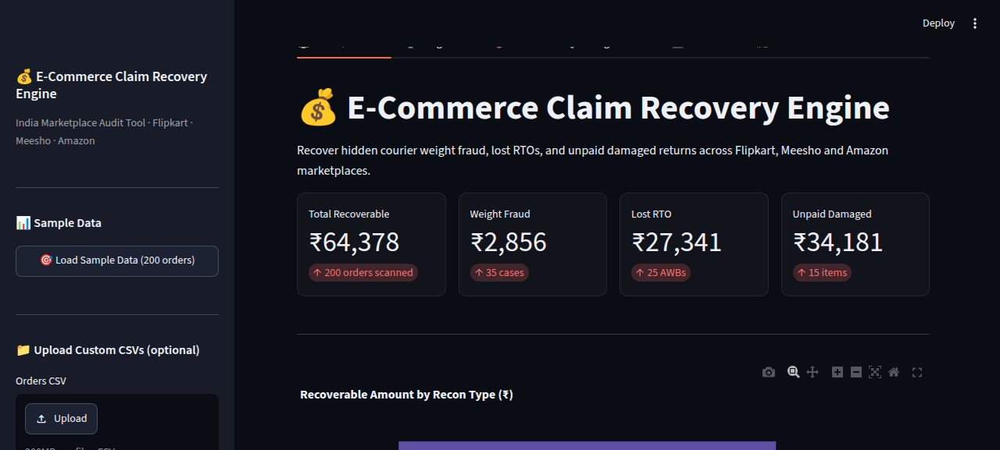
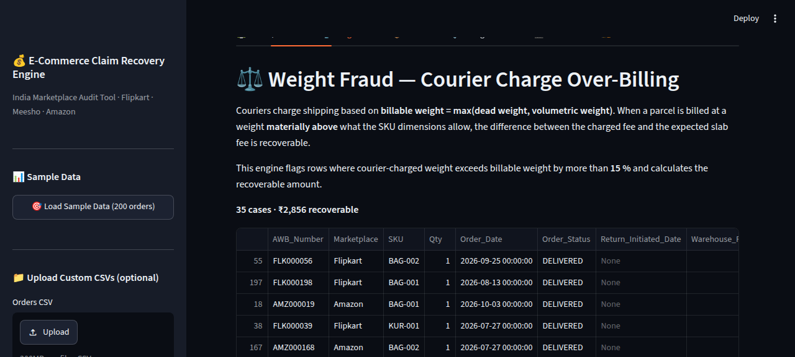
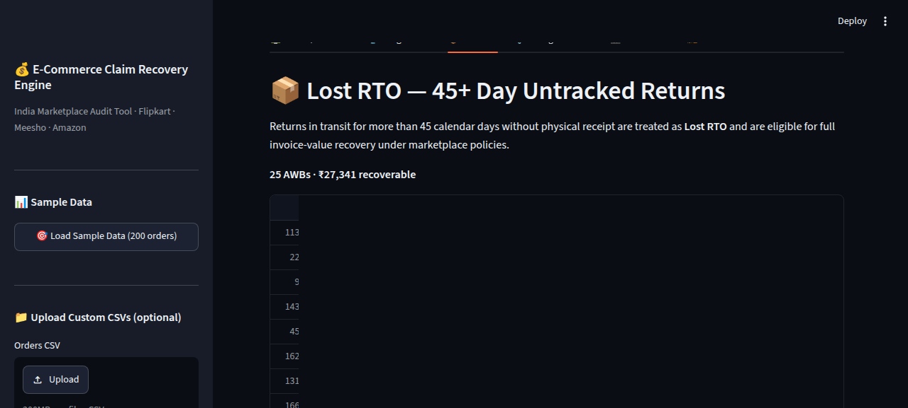
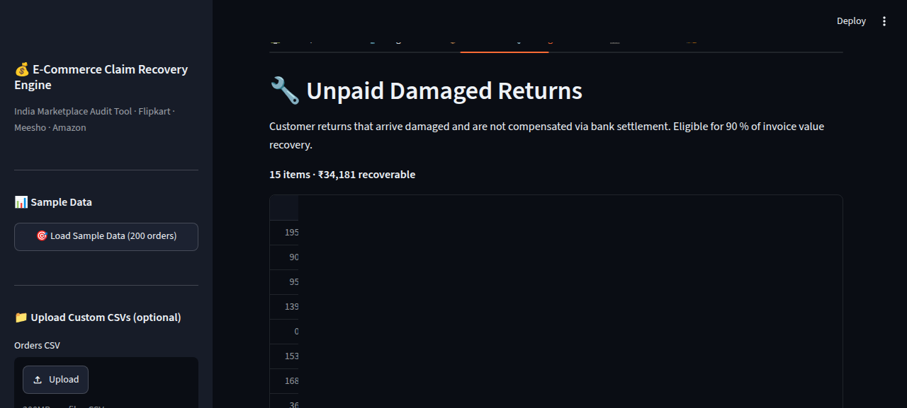
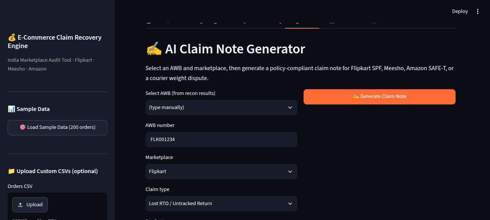
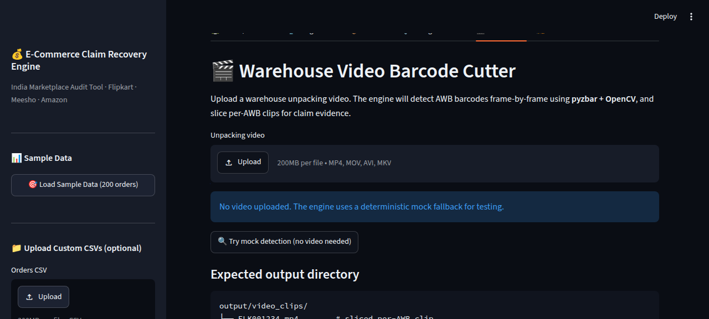

# 💰 E-Commerce Claim Recovery Engine

Recover ₹34,800+ in hidden courier weight fraud, lost RTOs, and unpaid damaged returns for Flipkart, Meesho, and Amazon sellers.

## What problem does it solve?
Weight‑overcharge fraud, 45‑day‑plus lost returns (RTO), and unpaid damaged returns strain seller cash‑flows. This tool clears those leaks.

## 3 Engines
1. **CSV Reconciliation & Weight Audit** – Detects over‑charged parcels, 45‑plus‑day RTOs, and unpaid damaged returns.
2. **Warehouse Video Barcode Cutter** – Splits unpacking videos into AWB‑labeled clips.
3. **AI Policy‑Compliant Claim Drafter** – Generates marketplace‑specific draft notes.

## Screenshots

**Overview Dashboard — ₹64,378 recoverable from 200 orders:**



**Weight Fraud tab — 35 overcharged parcels:**



**Lost RTO tab — 45+ day unreconciled returns:**



**Damaged Returns tab — customer returned damaged, no settlement:**



**Claim Notes generator — Flipkart SPF / Meesho / Amazon SAFE-T templates:**



**Video Cutter — warehouse unpacking video barcode detector:**



## Installation
```
git clone https://github.com/0xshaikh/ecom-claim-recovery-engine
cd ecom-claim-recovery-engine
python -m venv venv
source venv/bin/activate
pip install -r requirements.txt
python generate_sample_data.py
streamlit run app.py
```

## Quick Start

```bash
# 1. Load 200 sample orders with one click
#    Open sidebar → click "Load Sample Data"

# 2. Run reconciliation
#    Click "Run Reconciliation"

# 3. Explore 5 tabs:
#    🏠 Overview · ⚖️ Weight Fraud · 📦 Lost RTO · 🔧 Damaged Returns · ✍️ Claim Notes · 🎬 Video Cutter

# 4. Download Excel report
#    Click "Download Complete Report (.xlsx)"
```

## Sample Data

`generate_sample_data.py` creates 200 realistic Indian e-commerce orders with deliberate leak patterns:

- **35 weight fraud** — courier charged 2-4x actual billable weight
- **25 lost RTO** — in transit 45+ days, warehouse never received
- **15 unpaid damaged returns** — customer returned damaged, no settlement
- **125 clean** — normal delivered orders

Expected recoverable: **₹64,378** (₹2,856 weight fraud + ₹27,341 lost RTO + ₹34,181 unpaid damaged).

## Daily SOP for Sellers
1. Export 90‑day orders, settlement, SKU lists.
2. Run recon locally, screenshot executive summary.
3. Submit claims via marketplace portal.
4. Engage AI claim note generator.

## Tech Stack
Python, Streamlit, pandas, plotly, openpyxl, (optional) google‑genai.

## License
MIT © 2026 Anas Shaikh.
